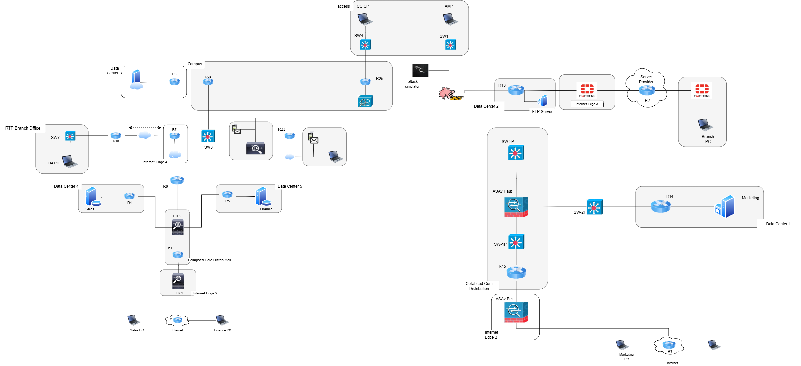
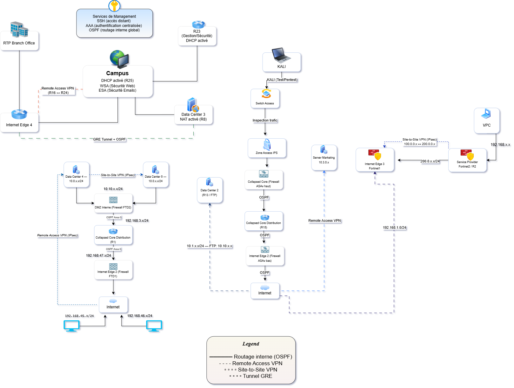

# 🛡️ Architecture de Cybersécurité Multicouche : Conception et Automatisation

> Projet de Fin d'Études (PFE) — ESPRIT, 2025-2026
> Réalisé par **Arij Nahdi** · Encadrant ESPRIT : M. Hamdi Bouslehi · Encadrant entreprise : M. Khalil Nawar (OneTech Business Solution)

Conception, déploiement et automatisation d'une infrastructure de sécurité défensive en **défense en profondeur** (zones WAN / DMZ / LAN), administrée via **Ansible**, **Terraform**, **Python** et un pipeline **CI/CD GitLab**.



---

## 📌 Contexte et problématique

Les configurations manuelles (CLI) d'équipements de sécurité hétérogènes provoquent des erreurs humaines, des politiques incohérentes et des déploiements lents.

**Question centrale :** comment concevoir une architecture de cybersécurité multicouche efficace et en automatiser la gestion pour garantir cohérence, réactivité et fiabilité ?

## 🏗️ Architecture

| Équipement | Zone | Rôle |
|---|---|---|
| FortiGate 500E | WAN / Périmètre | Pare-feu principal, inspection SSL/TLS, VPN SSL, VPN site-à-site |
| Cisco ASA | DMZ | Pare-feu secondaire, contrôle d'accès inter-zones |
| Cisco FTD (FDM) | DMZ / LAN | Access Control Policy, SSL Decryption |
| Snort IPS | DMZ / LAN | Détection et prévention d'intrusions (mode inline) |
| Cisco WSA | LAN | Filtrage web (catégories URL, HTTPS proxy) |
| Cisco ESA | DMZ | Sécurité email (anti-spam, anti-virus, DLP, SPF/DMARC) |
| Cisco CSR1000v | WAN / DMZ | Routage inter-zones, NAT |
| Cisco Catalyst 2960 | LAN | Commutation, VLANs |

### Flux entre zones

| Source | Destination | Statut |
|---|---|---|
| WAN | DMZ | ✅ Autorisé (web, email) |
| WAN | LAN | ❌ Interdit |
| LAN | WAN | ✅ Autorisé (filtré via WSA) |
| LAN | DMZ | ✅ Autorisé |
| DMZ | LAN | ❌ Interdit |
| VPN SSL | LAN | ✅ Autorisé |



## ⚙️ Automatisation

Le dossier [`ansible/`](ansible/) contient le projet `ansible-network-lab` :

```
ansible/
├── inventory.ini          # Inventaire des équipements
├── group_vars/all         # Variables globales
├── roles/
│   ├── fortinet_fw        # FortiGate
│   ├── asa_fw             # Cisco ASA
│   ├── cisco_router       # Routeurs
│   ├── cisco_switch       # Switches
│   └── linux_ips          # Snort IPS
├── site.yml               # Playbook principal (déploiement global)
├── backup.yml             # Sauvegarde horodatée des configurations
├── drift_detection.yml    # Détection de dérive de configuration
├── deploy_acl.yml         # Déploiement des ACLs Cisco
└── collect_info.yml       # Collecte d'état des équipements
```

- **Terraform** (`terraform/`) : provisioning déclaratif et reproductible.
- **Python / Netmiko** (`scripts/`) : collecte d'informations et vérifications.
- **CI/CD GitLab** (`.gitlab-ci.yml`) : sauvegarde automatique à chaque push sur `main` (artefacts conservés 7 jours) et détection de dérive (manuelle ou planifiée).


## 🧪 Tests et validation

| Scénario | Outil | Résultat |
|---|---|---|
| Scan de ports | Nmap | 🛑 Bloqué par Snort IPS |
| Attaque par flood TCP (DoS) | hping3 | 🛑 Bloqué par Snort IPS |
| Man-in-the-Middle (ARP poisoning) | Ettercap | ⚠️ **Non détecté** (couche 2) |

> **Limite identifiée :** Snort analyse principalement les couches 3/4. L'ARP poisoning (couche 2) nécessite **Dynamic ARP Inspection (DAI)** sur les Catalyst 2960 ou un outil comme ARPwatch.
> ## 📸 Captures et configurations

Captures de configuration de chaque équipement, déployés sur EVE-NG :

| Équipement | Zone | Captures |
|---|---|---|
| FortiGate 500E | WAN / Périmètre | [Voir](docs/screenshots/fortigate) |
| Cisco ASA | DMZ | [Voir](docs/screenshots/asa) |
| Cisco FTD (FDM) | DMZ / LAN | [Voir](docs/screenshots/FTD) |
| Cisco WSA | LAN | [Voir](docs/screenshots/wsa) |
| Cisco ESA | DMZ | [Voir](docs/screenshots/esa) |
| Routeurs et switch | WAN / DMZ / LAN | [Voir](docs/screenshots/reseau) |
| Snort IPS et tests d'attaque | DMZ / LAN | [Voir](docs/screenshots/test) |

## 🧰 Technologies

`EVE-NG` · `KVM` · `Fortinet FortiGate` · `Cisco ASA / FTD / WSA / ESA` · `Snort` · `Ansible` · `Terraform` · `Python (Netmiko)` · `GitLab CI/CD` · `Kali Linux`

## 🚀 Utilisation

```bash
# Prérequis : Ansible, Python 3.x, accès aux équipements (lab EVE-NG)
git clone https://github.com/<votre-user>/<nom-du-repo>.git
cd <nom-du-repo>/ansible

# Adapter l'inventaire et les variables (voir inventory.example.ini)
cp inventory.example.ini inventory.ini

# Sauvegarde des configurations
ansible-playbook -i inventory.ini backup.yml

# Détection de dérive
ansible-playbook -i inventory.ini drift_detection.yml

# Déploiement complet
ansible-playbook -i inventory.ini site.yml
```

> ⚠️ Les identifiants sont à fournir via **Ansible Vault** ou variables d'environnement. Aucun secret n'est versionné dans ce dépôt.

## ⚠️ Limites et perspectives

- Environnement entièrement virtualisé (EVE-NG)
- FTD géré via FDM (et non FMC)
- Haute disponibilité / failover non implémentée
- Perspectives : SIEM (Splunk / ELK), HA, DAI, FMC, extension des playbooks (MAJ signatures IPS, rotation de certificats), Zero Trust

## 👩‍💻 Auteur

**Arij Nahdi** — Cybersecurity Engineer | Network Security | Infrastructure Automation
[LinkedIn](https://www.linkedin.com/in/) · [Email](mailto:)

## 📜 Licence

Projet académique. Voir [LICENSE](LICENSE).
