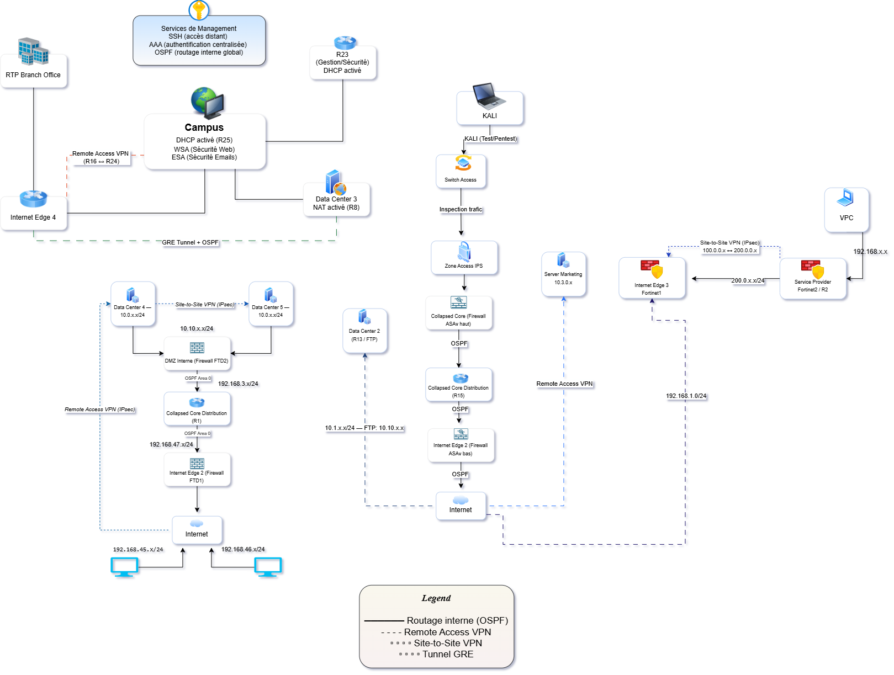
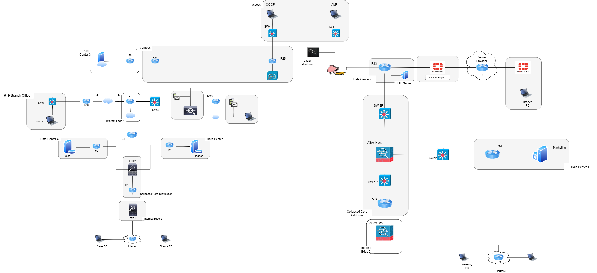

# Network Architecture

This directory contains the network architecture diagrams and topology of the Multi-Vendor Network Security project.

## Contents

- EVE-NG network topology
- Multi-layer network architecture diagram
- Network segmentation overview
- Security zones and connectivity
- 
1. Logical Security Architecture

The architecture follows a multi-layer defense-in-depth approach, organized into different security zones.

2. Physical Network Topology

The physical infrastructure is deployed in an EVE-NG virtual environment.

- ## Physical Network Topology

