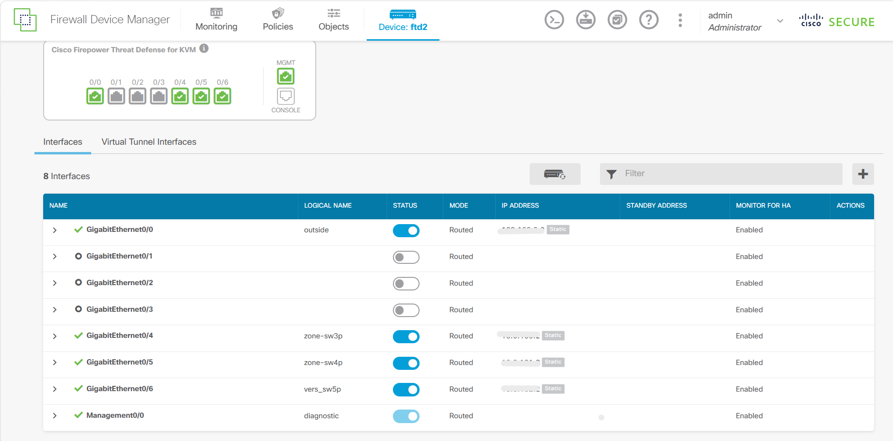
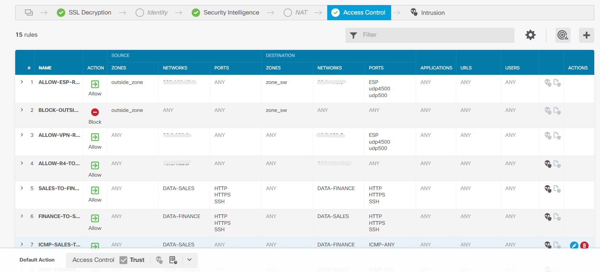
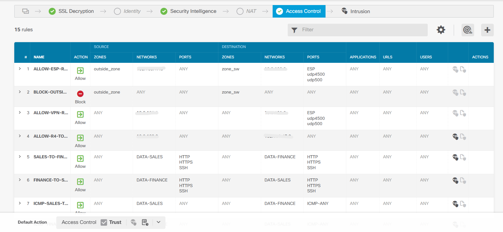
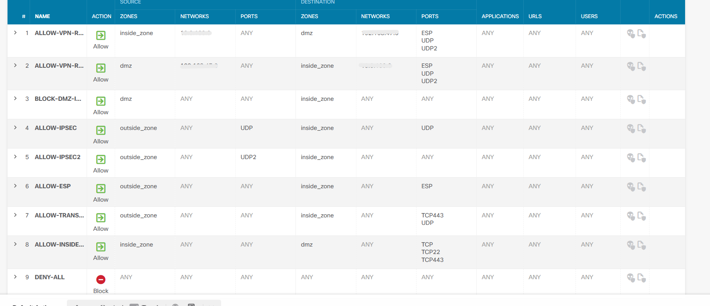
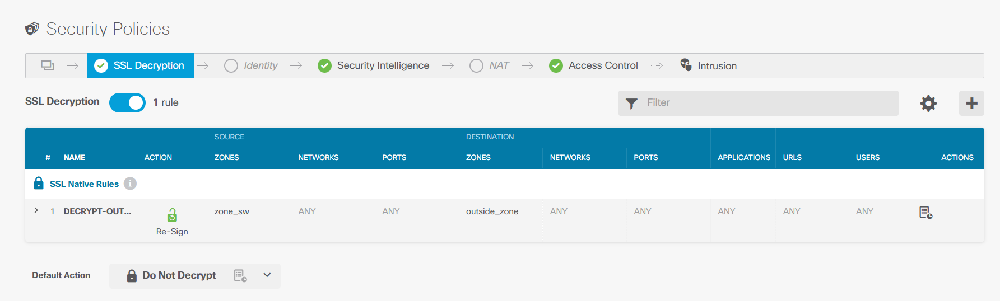
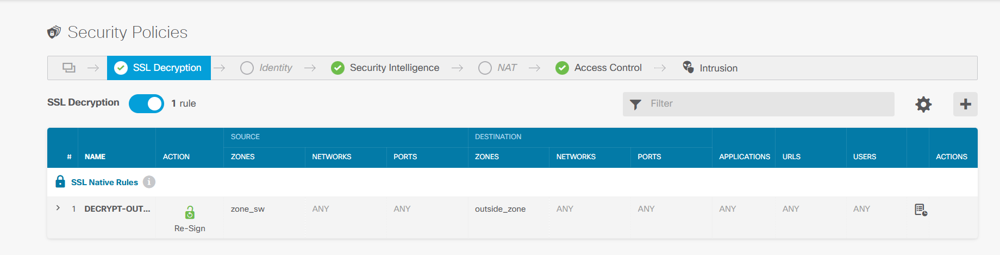

# Captures Cisco FTD (via FDM)

Le Cisco Firepower Threat Defense est administré via l'interface FDM (Firepower Device Manager).

## 1. Configuration des interfaces
Les interfaces du FTD sont configurées et assignées aux zones de sécurité correspondantes.

## 2. Access Control Policy
Règles d'autorisation et de blocage du trafic (Allow, Block, Trust).

## 3. SSL Decryption
Inspection du trafic HTTPS chiffré selon deux modes :
- **Decrypt - Resign** : trafic sortant (LAN vers Internet)
- **Do Not Decrypt** : flux sensibles (banques, services gouvernementaux)

