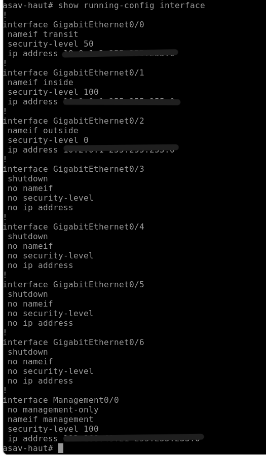
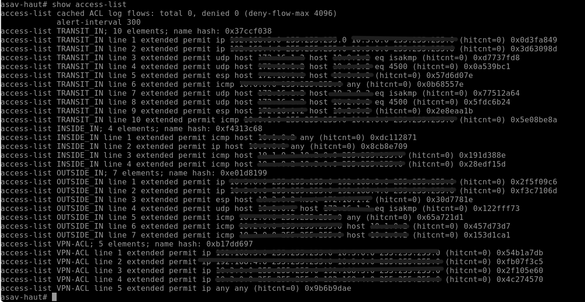
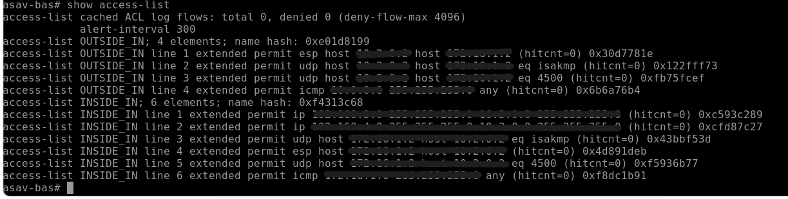
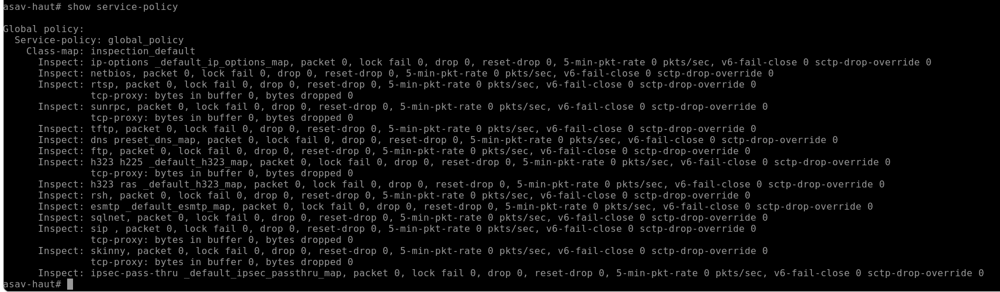
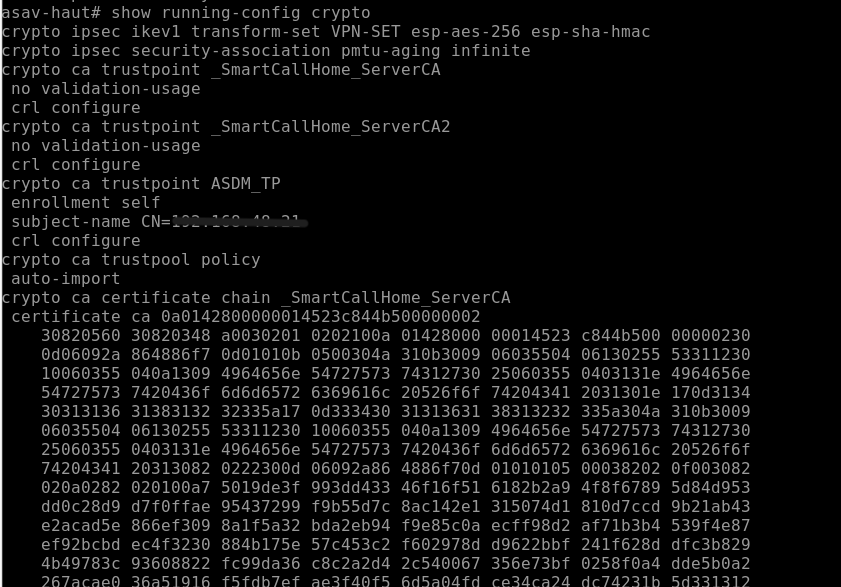
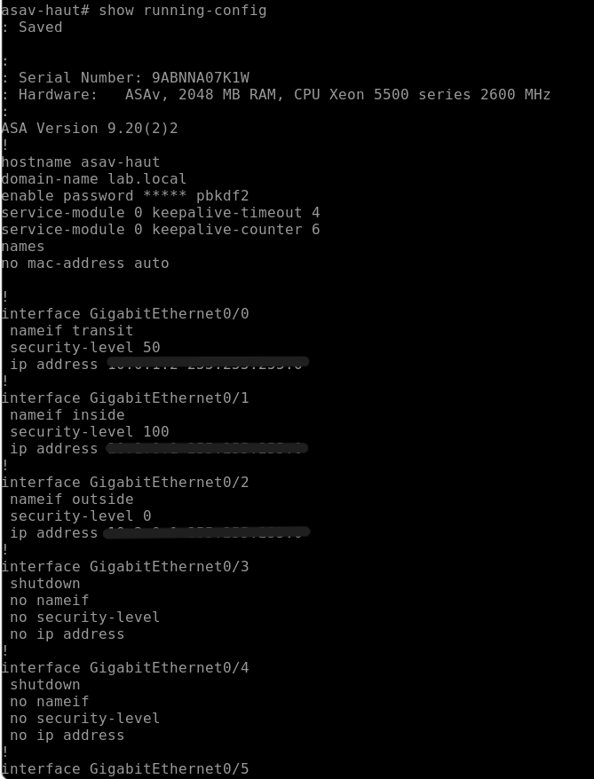
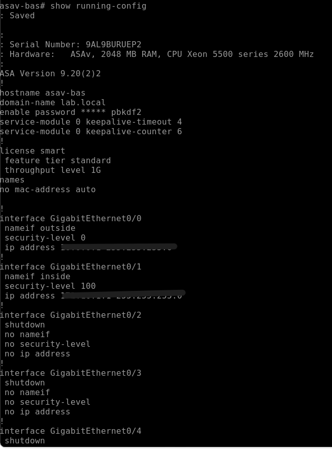

# Captures Cisco ASA

Deux pare-feux Cisco ASA virtuels (ASAv-haut et ASAv-bas) sont déployés dans la DMZ. Ils appliquent un filtrage stateful et segmentent le réseau en zones de sécurité.

## 1. Zones de sécurité
Les interfaces sont assignées à des zones avec un niveau de sécurité :
- **Outside** : niveau 0 (réseau non fiable)
- **DMZ** : niveau 50 (zone démilitarisée)
- **Inside** : niveau 100 (réseau interne de confiance)

## 2. Access Lists (ACL)
Les ACL définissent précisément le trafic autorisé ou bloqué entre les zones.

## 3. Service Policy
Politique d'inspection appliquée au trafic traversant l'ASA (inspection stateful des connexions).

## 4. VPN
Tunnel VPN sécurisé entre la DMZ et le réseau interne.

## 5. Configurations complètes (annexe)

### ASAv-haut

### ASAv-bas

> Les secrets et clés ont été masqués.
