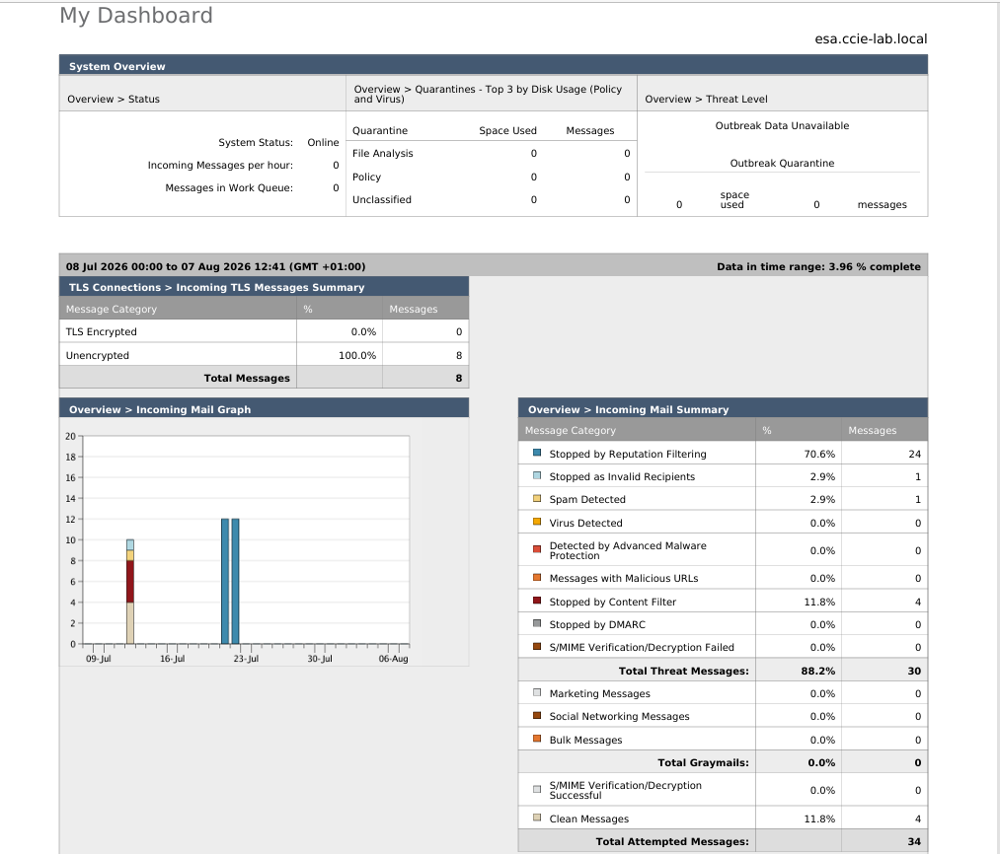
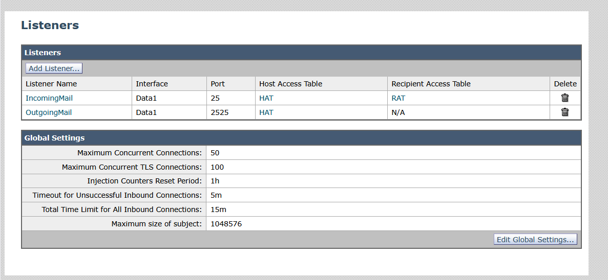
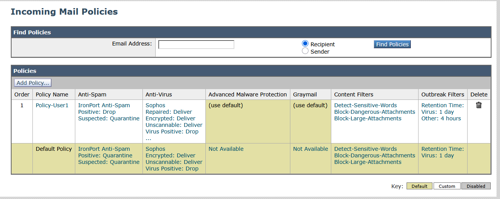
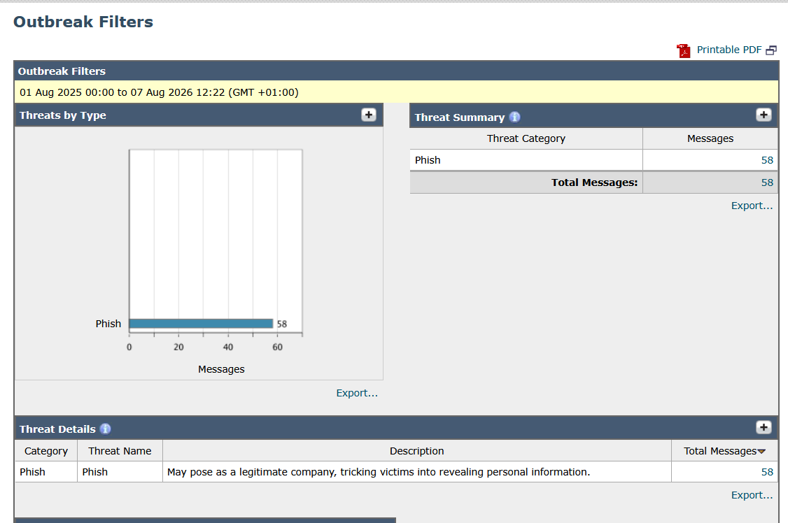
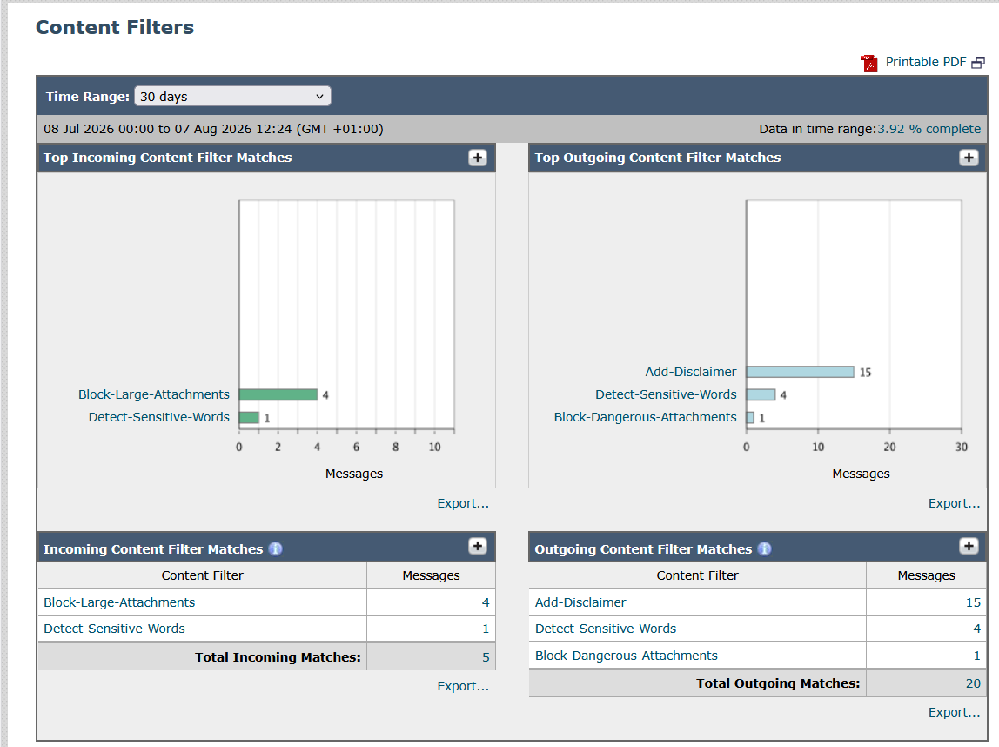
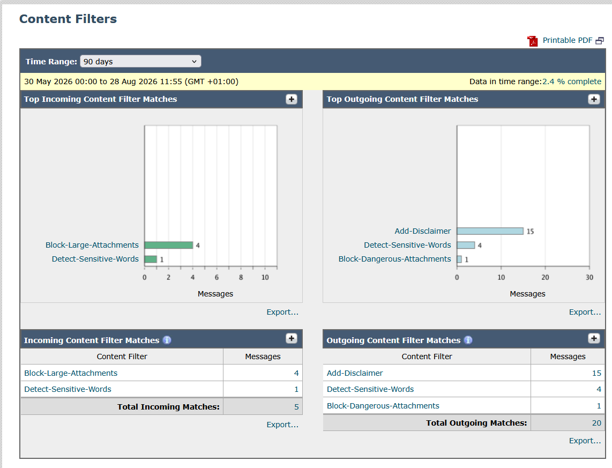
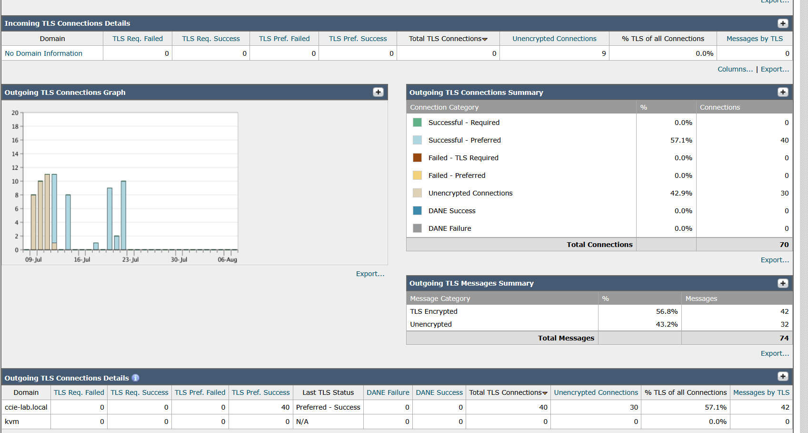
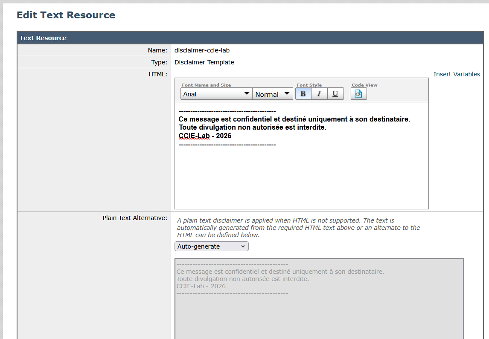
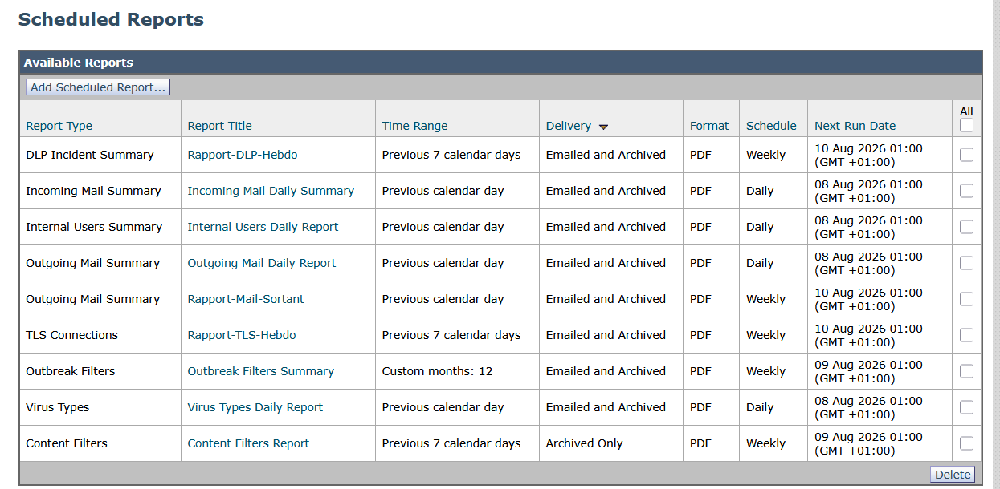
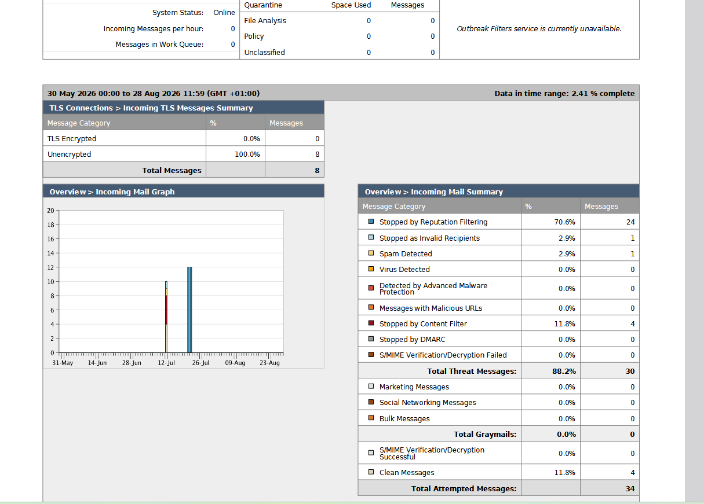

# Captures Cisco ESA (Email Security Appliance)

Le Cisco ESA protège les flux email de la DMZ : réception, politiques, filtrage de contenu, chiffrement et supervision.

## Vue d'ensemble : dashboard de monitoring
Tableau de bord de supervision de l'ESA : volume d'emails traités, menaces détectées et état du système.

## 1. Configuration des listeners
Deux listeners gèrent les flux email :
- **IncomingMail** : réception des emails provenant de l'extérieur.
- **OutgoingMail** : envoi des emails vers l'extérieur.

## 2. Mail Policies
Deux politiques sont définies :
- **Policy-User1** : règles adaptées à des utilisateurs spécifiques.
- **Default Policy** : politique par défaut pour tous les autres utilisateurs.

## 3. Outbreak Filters
Configurés au niveau 3 pour bloquer les campagnes d'emails malveillants en cours, à partir de la threat intelligence Cisco Talos.

## 4. Content Filters
Filtres de contenu actifs analysant les mots-clés, les pièces jointes et la taille des messages.

Détail d'un filtre (annexe) :

## 5. Chiffrement TLS
Chiffrement activé avec TLSv1.2 (ECDHE-RSA-AES256) pour garantir la confidentialité des messages en transit.

## 6. Disclaimer
Message ajouté automatiquement en pied de page de tous les emails sortants.

## 7. Rapports planifiés
Rapports générés automatiquement au format PDF.

Exemple de rapport PDF généré (annexe) :

