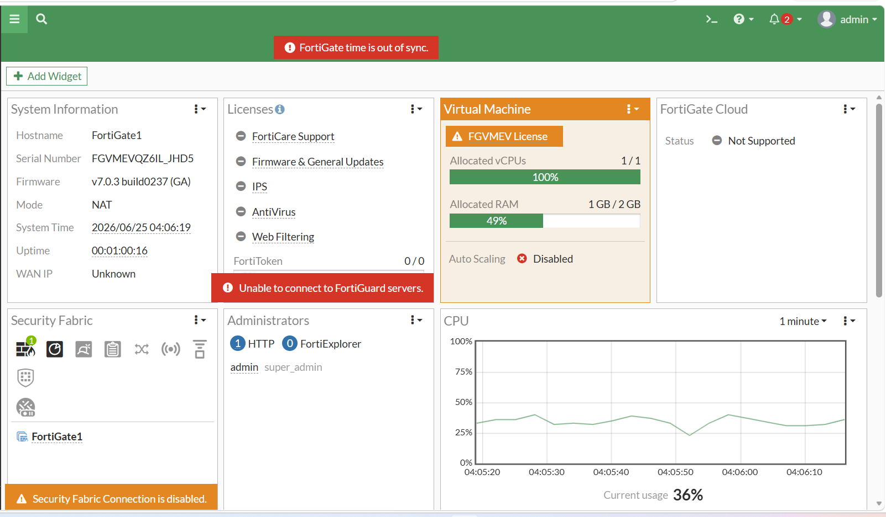
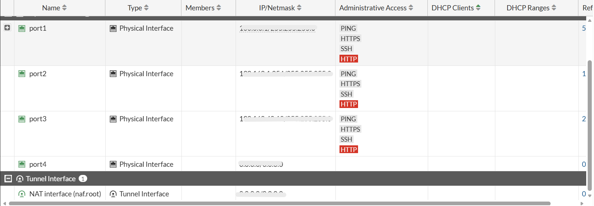
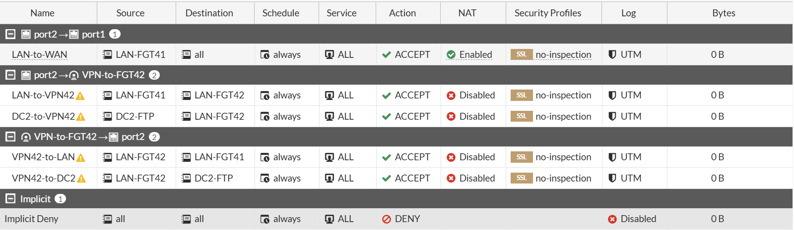
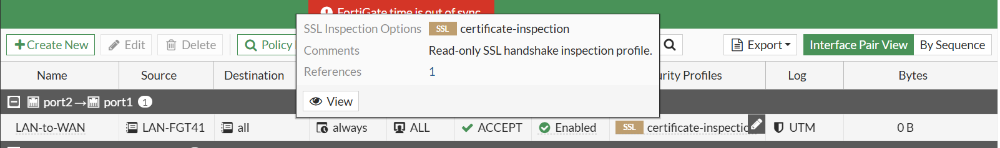
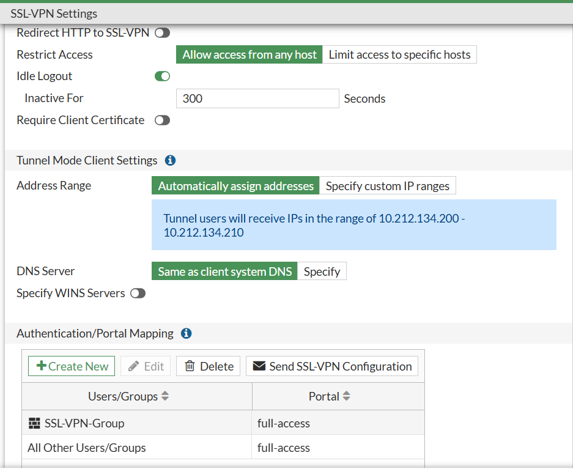
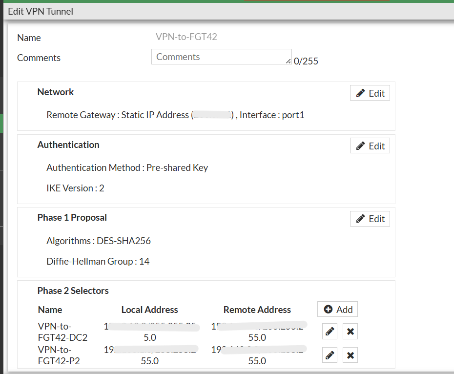
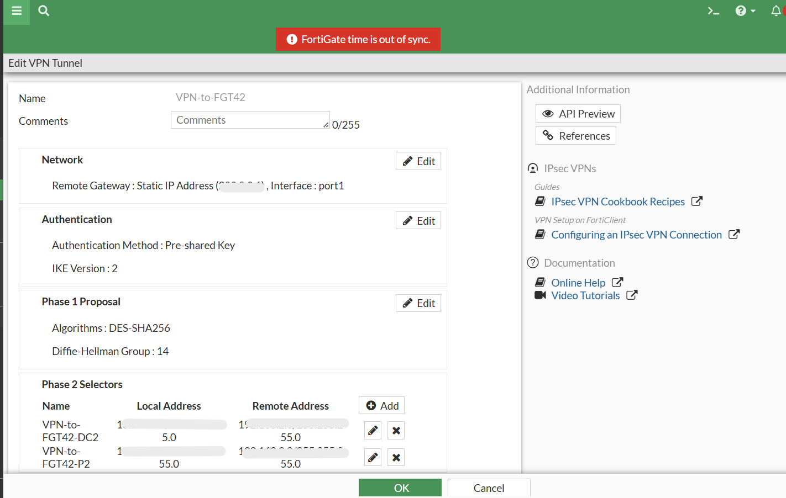
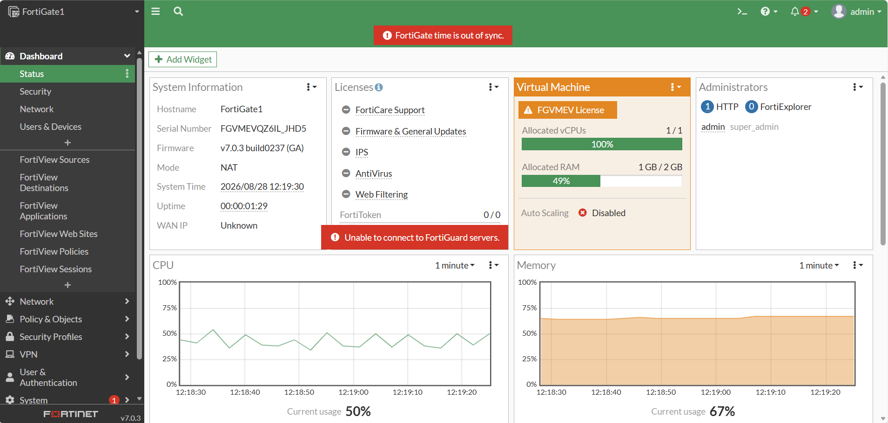

# Captures FortiGate 500E

Deux instances FortiGate (Fortinet1 et Fortinet2) sont déployées de façon symétrique pour la redondance. Les captures ci-dessous illustrent une instance représentative ; la même procédure a été appliquée à la seconde avec son propre adressage.

## 1. Configuration des interfaces
Chaque interface est configurée avec son adresse IP et associée à sa zone de sécurité (WAN, DMZ, LAN).

## 2. Politiques de filtrage
Règles d'autorisation et de blocage du trafic entre les zones : zone source, zone destination, services autorisés et action.

## 3. Inspection SSL/TLS
Déchiffrement et inspection du trafic HTTPS pour appliquer les politiques de sécurité sur les flux chiffrés.

## 4. VPN SSL
Accès distant sécurisé au réseau interne via navigateur web ou FortiClient.

## 5. VPN Site-à-Site (IPsec)
Tunnel IPsec chiffré entre Fortinet1 et Fortinet2 pour interconnecter les deux sites.

## 6. Interface de gestion
Interface web d'administration du FortiGate 500E.

