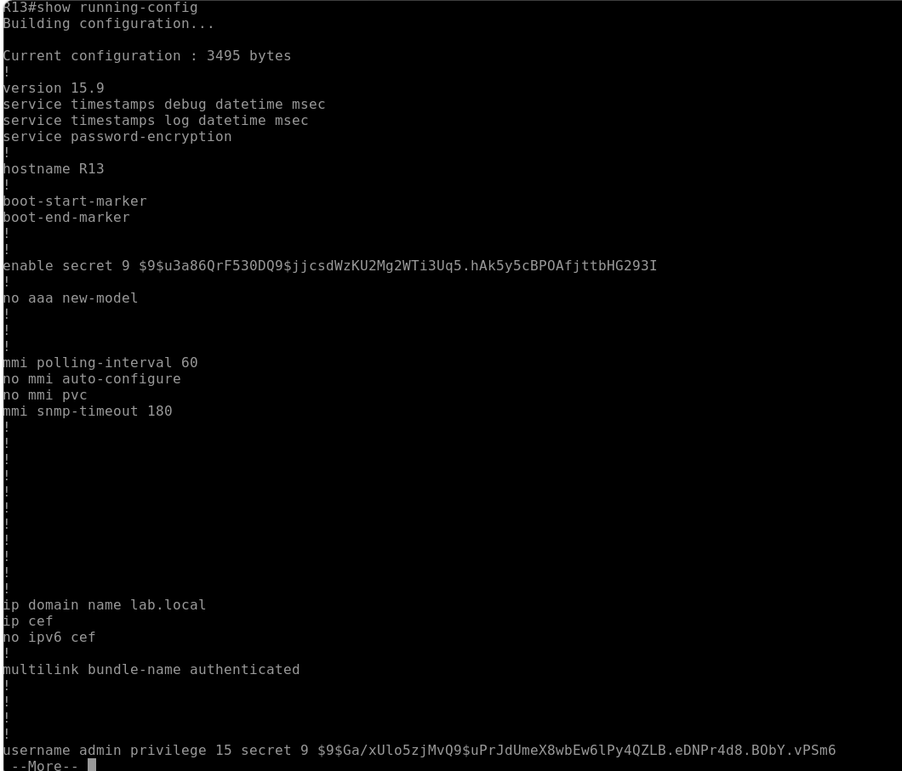
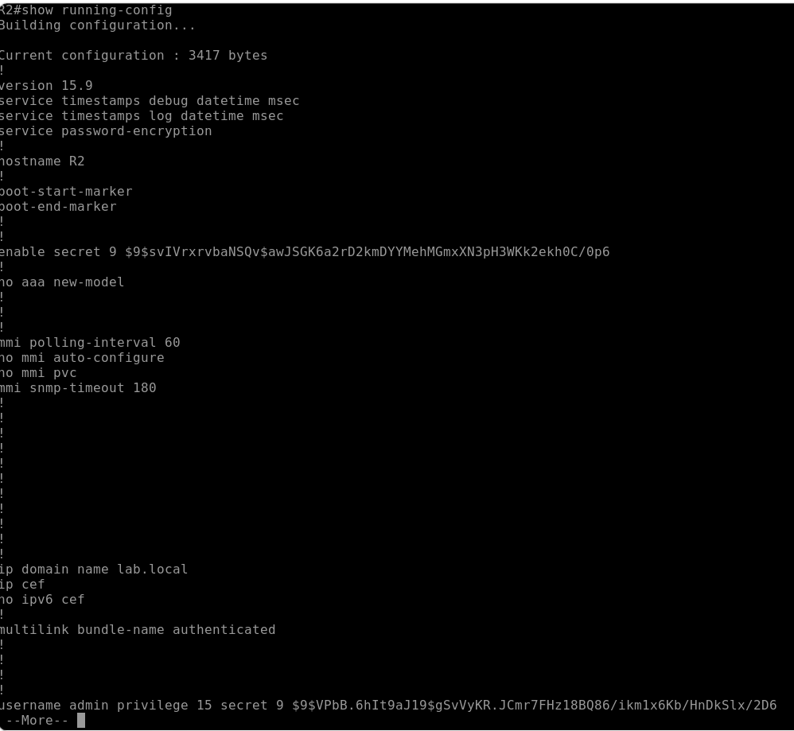
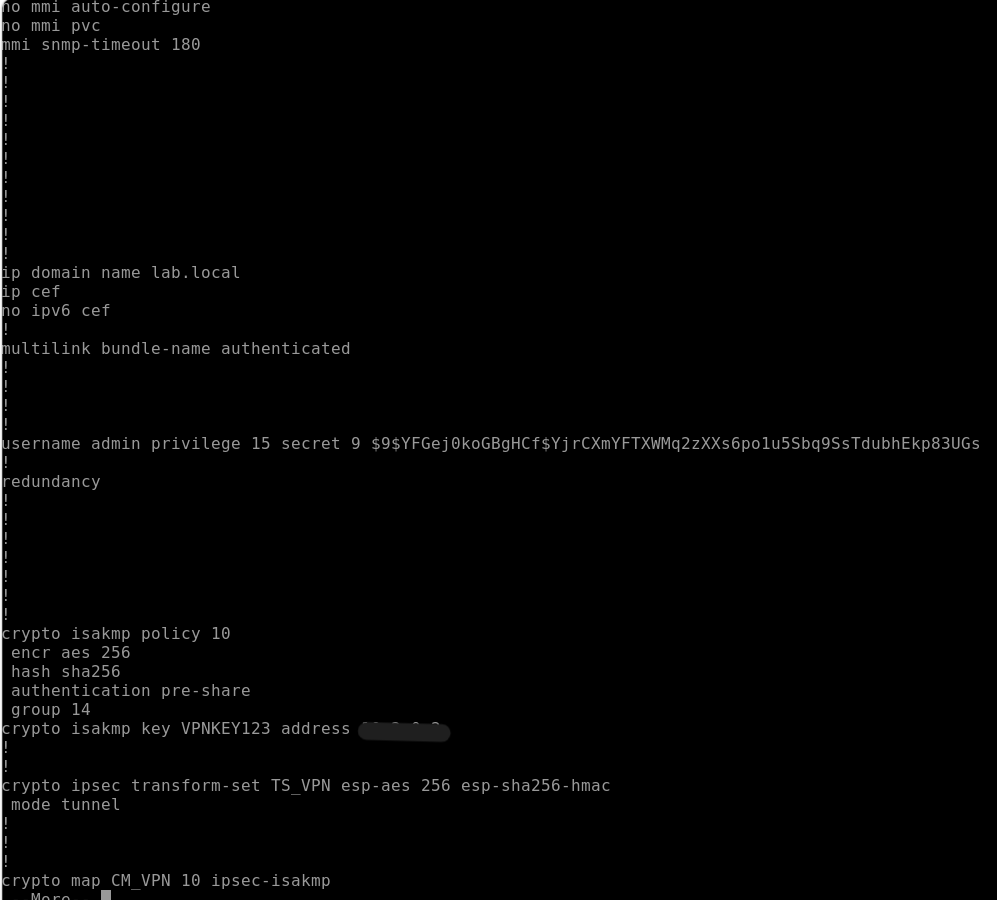
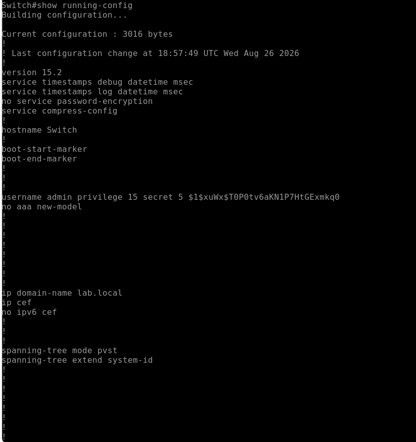

# Routeurs et switch : running-configurations

Le routage inter-zones et la segmentation du réseau sont assurés par des routeurs Cisco CSR1000v et un switch Cisco Catalyst 2960. Les captures ci-dessous présentent leurs configurations en cours (`show running-config`).

| Équipement | Rôle |
|---|---|
| Routeurs (CSR1000v) | Routage inter-zones, NAT |
| Switch SW1 (Catalyst 2960) | Commutation, VLANs, isolation du trafic |

## Routeurs

### R13

### R2

### R3

## Switch

### SW1

> Les secrets et mots de passe ont été masqués. SW1 est aussi la cible du test Ettercap (voir le dossier des tests de sécurité) : une protection **Dynamic ARP Inspection (DAI)** est une amélioration envisagée.
