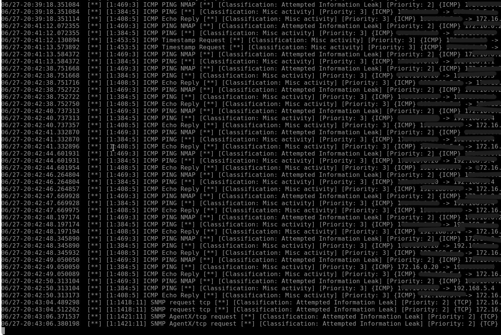
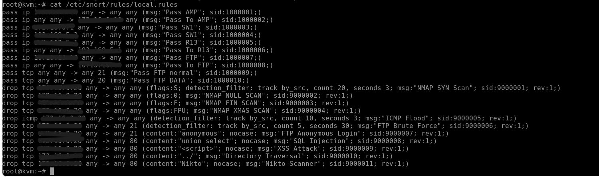
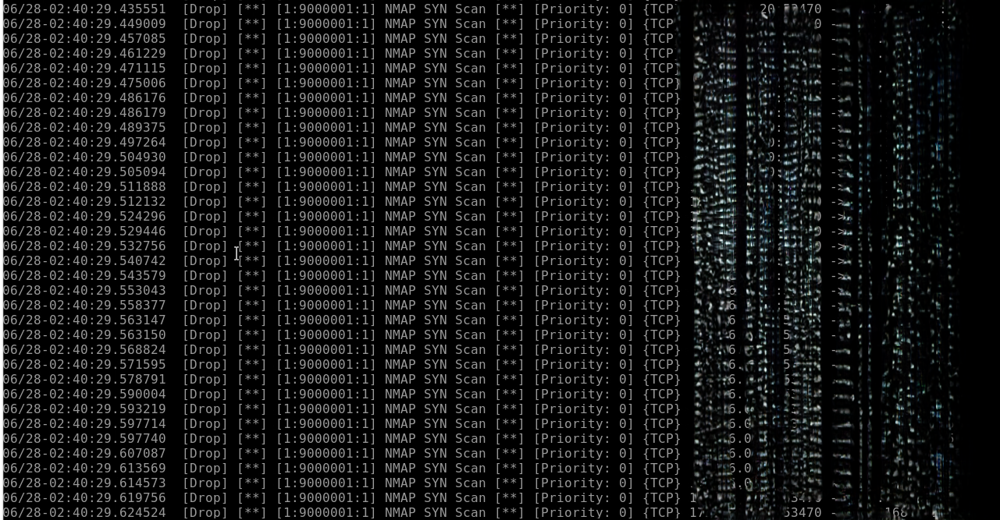
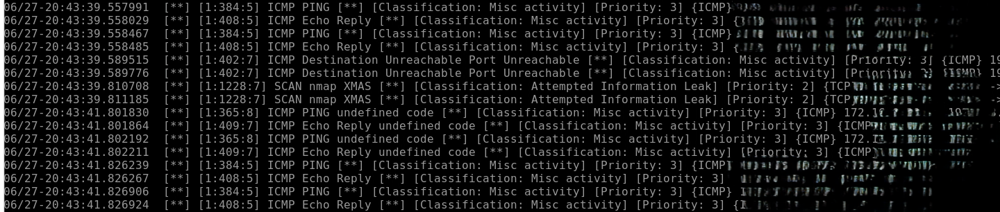
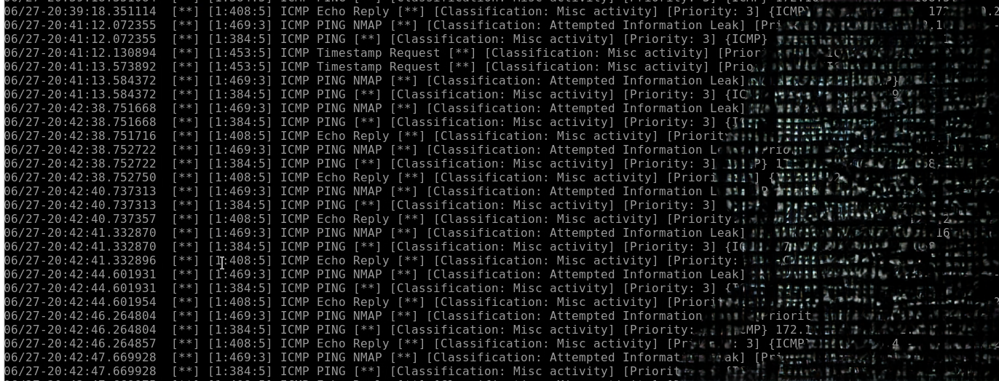
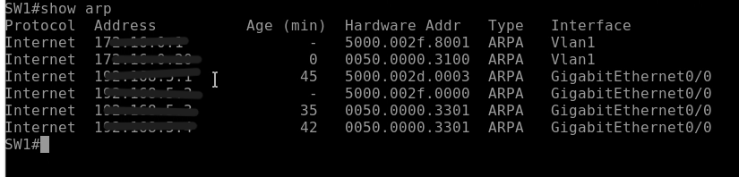
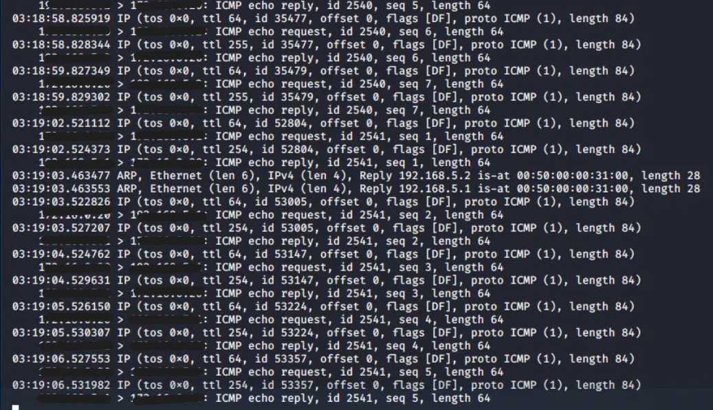

# Snort IPS et tests de sécurité

Snort IPS est déployé en mode inline sur le chemin du trafic. Les attaques sont simulées depuis une machine Kali Linux placée dans la zone WAN, vers une cible située dans le LAN.

| Élément | Rôle | Zone |
|---|---|---|
| Kali Linux | Machine attaquante | WAN |
| Snort IPS | Détection et prévention inline | DMZ |
| Machine cible | Serveur cible | LAN |

## 1. Configuration de Snort IPS

### Déploiement en mode inline
Snort est placé sur le chemin du trafic : il intercepte et analyse tous les flux en temps réel, et peut bloquer les paquets malveillants.

### Règles de détection
Règles de détection de scans de ports et de protection contre les attaques par flood.

## 2. Scénario 1 : scan de ports (Nmap)

Commande utilisée depuis Kali :
nmap -sS -sV -O <adresse_cible>

**Résultat : bloqué.** Snort a détecté le scan grâce à ses règles de type `portscan`, bloqué les paquets de sonde et généré une alerte dans les logs.

## 3. Scénario 2 : flood TCP (hping3)

Commande utilisée depuis Kali :
hping3 -S --flood -V -p 80 <IP_cible>

**Résultat : bloqué.** Snort a détecté le volume anormal de paquets TCP et activé la protection contre les floods. Une alerte indique la source et le type d'attaque.

## 4. Scénario 3 : Man-in-the-Middle (Ettercap)

Commande utilisée depuis Kali :

ettercap -T -q -M arp:remote /<IP_cible1>/ /<IP_cible2>/

**Résultat : non détecté.** L'attaque a corrompu la table ARP du switch SW1 et le trafic ICMP entre les deux cibles transite par Kali.

**Limite identifiée :** l'ARP poisoning opère à la couche 2, alors que Snort analyse principalement les couches 3 et 4. Pistes d'amélioration : activer **Dynamic ARP Inspection (DAI)** sur les Catalyst 2960, ou déployer **ARPwatch**.

## Synthèse

| Scénario | Outil | Résultat | Équipement |
|---|---|---|---|
| Scan de ports | Nmap | Bloqué | Snort IPS |
| Flood TCP | hping3 | Bloqué | Snort IPS |
| Man-in-the-Middle | Ettercap | Non détecté | Snort IPS |
