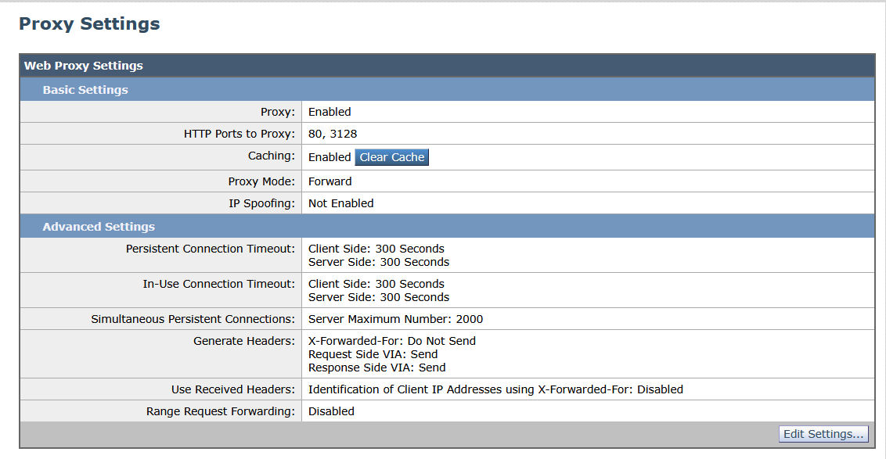
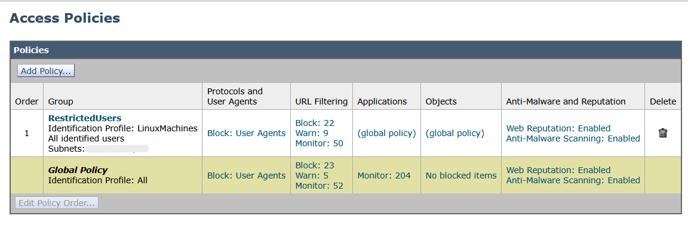
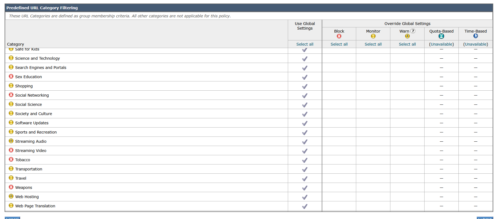
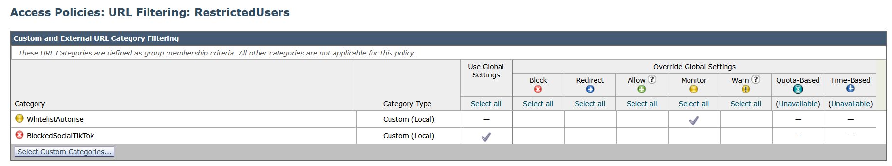
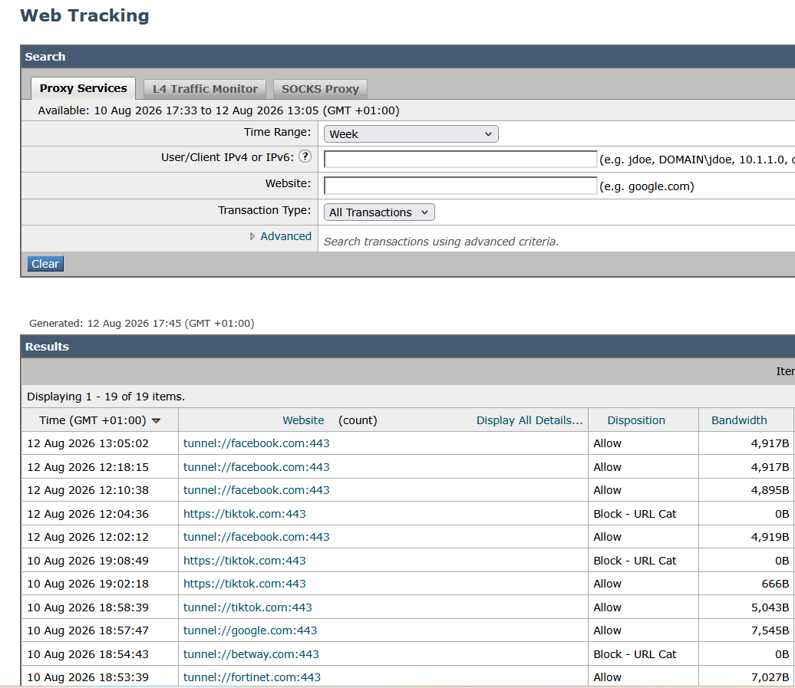
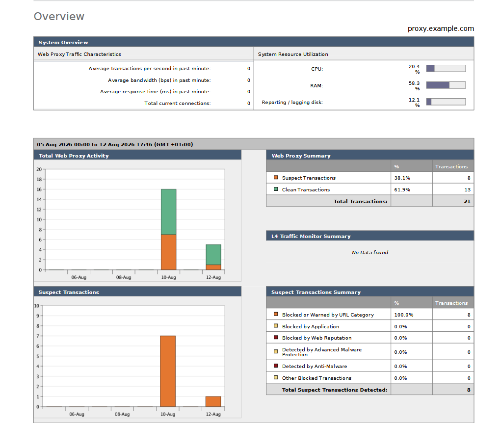

# Captures Cisco WSA (Web Security Appliance)

Le Cisco WSA assure le filtrage web du trafic sortant du LAN : proxy, politiques d'accès, filtrage par catégories et reporting.

## 1. Configuration du proxy
Deux modes sont configurés :
- **Proxy explicite** (port 3128) : les navigateurs envoient leurs requêtes directement au WSA.
- **WCCP transparent** : le trafic web est redirigé vers le WSA sans configuration des postes clients.

## 2. Access Policies par subnet
Des règles de filtrage différenciées selon l'origine des requêtes.

## 3. Filtrage URL par catégories
Blocage ou autorisation de groupes de sites selon leur nature (malveillants, phishing, jeux en ligne, contenus adultes).

## 4. Whitelisting (Custom URL Category)
Liste blanche de sites autorisés, indépendamment de leur catégorie globale.

## 5. Web Tracking et Reporting
Enregistrement et analyse des requêtes web, avec un tableau de bord en temps réel.

